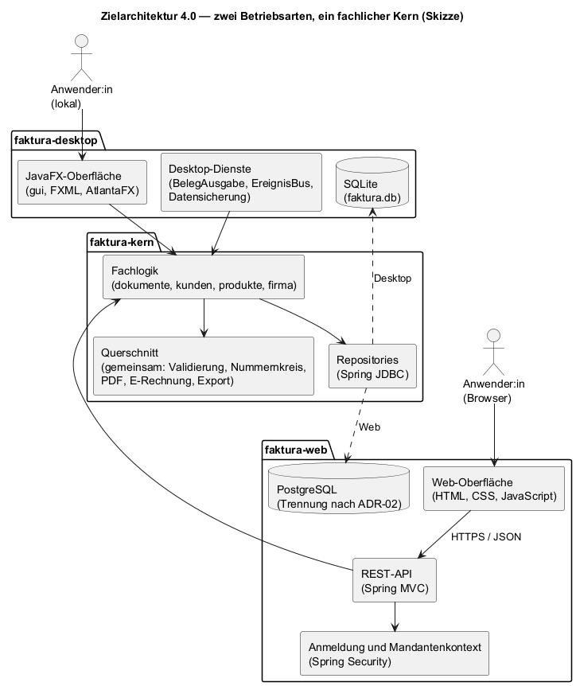

# Dokumentenhistorie

| Version | Datum      | Grund der Änderung  |
|----|------|------------------------------|
| 0.1 | 18.10.2026 | Erstfassung: Skizze der Weiterentwicklung zu zwei Betriebsarten (Desktop und Web/SaaS) |
| 0.2 | 18.10.2026 | Phase 13 erledigt (Freigabe 3.1.0); Lehre zu Vorabversionen im Installer |

# Anlass und Zielbild

Eine Rückmeldung zum Projekt schlug vor, Faktura „mandantenfähig ins Internet“ zu bringen.
Diese Skizze beschreibt, wie das gelingen kann, ohne das bisherige Produkt aufzugeben: Am Ende
stehen **zwei Betriebsarten aus einer Codebasis**. Sie ist eine Planungsgrundlage, keine
Spezifikation — Umfang und Anforderungen legt erst Phase 14 verbindlich fest.

## Zwei Betriebsarten

|              | **Faktura Desktop**              | **Faktura Web**                    |
|--------------|----------------------------------|------------------------------------|
| Nutzung      | lokal installiert (MSI, JAR)     | im Browser                         |
| Oberfläche   | JavaFX                           | HTML, CSS, JavaScript              |
| Datenhaltung | SQLite auf dem eigenen Rechner   | PostgreSQL auf einem Server        |
| Benutzer     | eine Person, ohne Anmeldung      | Anmeldung, mehrere Mandanten       |
| Fachlogik    | gemeinsamer Kern                 | gemeinsamer Kern                   |

Ein **Mandant** ist eine Firma mit eigenem Firmenprofil, eigenen Kunden, Produkten und Belegen
sowie eigenen Nummernkreisen. Mandanten sehen gegenseitig keine Daten.

## Datensouveränität bleibt Produktversprechen

Faktura versteht sich bisher ausdrücklich als lokal betriebene Alternative zu SaaS-Lösungen
(Projektübersicht, Projektzweck; Lastenheft PZ-04). Die Web-Variante stellt das nicht in Frage:

- Die Desktop-Variante bleibt vollwertig und wird weiter ausgeliefert.
- Die Web-Variante ist selbst hostbar. Wer seine Daten keinem fremden Betreiber anvertrauen
  will, betreibt sie auf einem eigenen Server.
- Jeder Mandant kann seine Daten jederzeit vollständig exportieren; der Export existiert heute
  schon (`GesamtExport`, Q-08) und wird je Mandant angeboten.

## Abgrenzung

Die Web-Variante entsteht als studentisches Portfolio-Projekt. Öffentlich erreichbar ist nur eine
**Demo-Instanz mit fiktiven Daten**. Kommerzieller Betrieb mit echten Kundendaten — mit
Auftragsverarbeitung nach Art. 28 DSGVO, Haftung und Verfügbarkeitszusagen — ist kein Ziel
dieser Roadmap. Wie bisher gilt: keine pauschale Compliance-Aussage.

## Bezug zu den Modulen des Semesters

Die Weiterentwicklung begleitet drei Module des Wintersemesters 2026/27. Jede Phase hat damit
einen fachlichen Schwerpunkt und einen prüfbaren Nachweis im Repository.

| Modul | Inhalte im Projekt | Phasen | Nachweis |
|--------------------|--------------------------------------|------|--------------------------|
| Software Engineering 2 | Anforderungen fortschreiben, Architekturentscheidungen (ADR), Modularisierung, Teststrategie für zwei Betriebsarten, CI/CD | 14, 15, 19 | neue Fassungen von Lastenheft und Pflichtenheft, ADRs, Build beider Varianten |
| Webbasierte Systeme | HTTP und REST, Oberfläche mit HTML, CSS und JavaScript, Formulare und Validierung, Sitzungen und Anmeldung, optional PHP | 17, 18 | Web-Oberfläche, API-Beschreibung, Sicherheitstests |
| Datenmanagement | ER-Modell des Bestands, Normalisierung und bewusste Denormalisierung (Snapshots), Datentypen, Fremdschlüssel, Transaktionen und Isolation, Mandantentrennung, Sicherung | 16, 19 | PostgreSQL-Schema, Nebenläufigkeitstest des Nummernkreises, Isolationstests |

# Ausgangslage und Zielarchitektur

## Was bleibt

Die fachlichen Regeln liegen heute in den Services und im Domänenmodell, nicht in der
Oberfläche. Beide Betriebsarten nutzen denselben Kern; keine dieser Regeln wird für das Web
neu geschrieben.

| Regel | Anforderung | In der Web-Variante |
|------------------------------------------|----------------|----------------|
| Lückenlose Nummernvergabe in derselben Transaktion wie das Speichern | GR-01, A-F-12 | je Mandant |
| Versendete und stornierte Belege sind unveränderlich; Ausgleich über eine Stornorechnung | GR-02, A-F-24, A-F-29 | unverändert |
| Snapshots von Kunde und Preisen, Aussteller und Einheiten | C-F-06, A-F-27, RC-03 | unverändert |
| Steuer je Steuersatz und gespeicherter Betragsstand | A-F-25, RC-02 | unverändert |
| E-Rechnung nur nach bestandener Offline-Prüfung | A-F-30, RC-04 | unverändert |
| Ohne Firmenprofil keine Belege | A-F-26 | je Mandant |
| Löschsperre für referenzierte Kunden und Produkte | GR-04 | je Mandant |

## Wo die Einzelplatz-Annahme heute festgeschrieben ist

Eine Durchsicht des Codes (Stand 3.1.0-rc.1) zeigt: Die Fachpakete `dokumente`, `kunden`,
`produkte`, `firma` und `gemeinsam` importieren kein JavaFX. Die Services liefern
Domänenobjekte, `Dokument` ist bereits für polymorphes JSON ausgezeichnet, und PDF und
E-Rechnung entstehen im Speicher. Die Annahme „eine Firma, ein Rechner, eine Person“ steckt
an folgenden Stellen:

| Stelle | Heute | Geplante Lösung | Phase |
|------------------|------------------------------|----------------------------|-------|
| `firmenprofil` (V2) | `CHECK (id = 1)`: genau eine Firma je Datenbank | bleibt und gilt je Mandant (ADR-02) | 16 |
| Primärschlüssel von `kunde`, `produkt`, `dokument` (V1) | die Nummer allein, z. B. `R-2026-000124` | bleibt bei Schema je Mandant; sonst Schlüssel mit Mandant | 16 |
| `nummernkreis` (V3), `JdbcNummernkreis` | Schlüssel `(bereich, jahr)`; das erste `INSERT` ist nur bei einem einzigen Schreiber sicher | je Mandant; nebenläufigkeitsfest | 16 |
| `Jdbc*Repository` | SQL je Klasse ausgeschrieben, kein zentraler Filter | bei Schema je Mandant unverändert nutzbar | 16 |
| `PersistenzKonfiguration` | eine SQLite-Datei, kein Verbindungspool | Konfiguration je Betriebsart | 15, 16 |
| Migration V1 | `AUTOINCREMENT` (nur SQLite) | eigener Migrationspfad für PostgreSQL | 16 |
| Beträge und Datumsangaben | als TEXT, unbekannte Beträge als Leertext | in PostgreSQL `NUMERIC` und `DATE`, unbekannt als `NULL` | 16 |
| `Datensicherung`, `UpgradeSicherung` | `VACUUM INTO` und `PRAGMA` (nur SQLite) | bleiben im Desktop; Web sichert über `pg_dump` | 15, 19 |
| `BelegAusgabe` | Druck und Mail über `java.awt.Desktop` | bleibt im Desktop; Web: Browserdruck, später SMTP | 15, 18 |
| `EreignisBus` | Abonnenten einer einzigen FX-Sitzung | bleibt im Desktop; Web lädt nach Aktionen neu | 15, 18 |
| `StandardDokumentService` | Storno durch `SYSTEM_BENUTZER = "Anwender"` | angemeldete Person | 15, 17 |
| FX-Klassen | einzelne Regeln in Dialogen und Ansichten | in den Kern verschieben | 15 |
| `LocalDate.now()` | Zeitzone des Rechners | `Clock` mit fester Zeitzone | 15 |
| Exporte | Ziel ist immer ein `Path` aus dem Dateidialog | zusätzlich als Bytes für Downloads | 15 |

## Konflikte mit bestehenden Anforderungen

Mehrere Anforderungen gelten heute für das ganze Produkt und schließen eine Web-Variante aus.
Sie werden in Phase 14 nicht gestrichen, sondern auf die Betriebsart Desktop beschränkt; die
Web-Variante erhält eigene Anforderungen.

| Anforderung | Heute | Vorschlag für Phase 14 |
|------------------------------|--------------------|------------------------------|
| PZ-04, Q-06: Daten ausschließlich lokal, keine Übertragung an externe Dienste | ganzes Produkt | nur Desktop; für Web eigene Datenschutzanforderungen (TLS, Mandantentrennung, Serverstandort, Export) |
| Nichtziele „Mehrbenutzer- oder Netzwerkfähigkeit“ und „Web-Applikation“ | ausgeschlossen | für die Betriebsart Web aufheben |
| Systemkontext und Rahmenbedingung „Einzelplatz“ | Desktop, lokal | um den Server-Kontext ergänzen |
| Benutzerrolle (eine konsolidierte Rolle) | eine Person | Rollen je Mandant und Betreiber:in |
| Q-01 bis Q-04: Leistung auf dem Endanwender-PC | ganzes Produkt | Q-04 (Start) nur Desktop; für Web Antwortzeiten auf einer festgelegten Server-Umgebung |
| Q-08: vollständiger Export | ganze Datenbank | je Mandant |
| RC-06: Sicherung über `VACUUM INTO`, geprüfte Upgrade-Sicherung | ganzes Produkt | nur Desktop; Web: Betreiber-Sicherung mit Rücksicherungsprobe |

## Zielarchitektur

Der Build wird in drei Maven-Module geteilt, die gemeinsam in diesem Repository liegen
(ADR-06). Der Kern kennt weder JavaFX noch einen bestimmten Datenbankdialekt; beide
Betriebsarten binden ihn ein.

| Modul | Inhalt | Wichtige Abhängigkeiten |
|----------------|----------------------------------------|----------------------|
| `faktura-kern` | Fachpakete `dokumente`, `kunden`, `produkte`, `firma`, `gemeinsam`; Repositories; Migrationen je Dialekt | Spring (Kontext, JDBC, Transaktionen), PDFBox, Mustang |
| `faktura-desktop` | `gui`, `FxAnwendung`, SQLite-Konfiguration, `BelegAusgabe`, `EreignisBus`, `Datensicherung`, `UpgradeSicherung`, `JsonDatenUebernahme` | Kern, JavaFX, AtlantaFX, sqlite-jdbc |
| `faktura-web` | REST-API, Anmeldung, Mandantenkontext, PostgreSQL-Konfiguration, Web-Oberfläche als statische Dateien | Kern, Spring Web, Spring Security, PostgreSQL-Treiber |

Funktionen je Betriebsart (Entwurf, verbindlich erst mit Phase 14):

| Funktion | Desktop | Web |
|------------------------------|----------------------|----------------------|
| Stammdaten, Dokumentenzyklus, Kennzahlen | ja | ja |
| PDF und E-Rechnung | Speichern als Datei | Download |
| Druck | Systemdrucker | über die PDF-Ansicht des Browsers |
| Mail | Standard-Mailprogramm | später über SMTP |
| Datensicherung | ZIP über `VACUUM INTO` | Betreiber-Sicherung (`pg_dump`) |
| Datenexport (CSV-ZIP) | gesamter Bestand | je Mandant |
| Mandanten | eine Firma | mehrere, strikt getrennt |
| Anmeldung | keine | erforderlich |

# Phasen

Die Nummerierung schließt an Phase 12 der Projektübersicht an. Jede Phase ist für sich
lieferbar, und die Desktop-Variante bleibt nach jeder Phase releasefähig. Die Reihenfolge ist
ein Vorschlag; Phase 14 legt Umfang und Prioritäten fest.

## Phase 13 — Ausgangsbasis

**Ziel:** Der Umbau beginnt auf einem freigegebenen Stand. Ein Umbau auf einem nicht
freigegebenen Stand würde zwei offene Baustellen vermischen.

**Nachweis:** Freigabe 3.1.0. **Erledigt am 18.10.2026:** Startzeit Q-04 eingehalten
(3,5–3,7 s), Upgrade des Installers von 3.0.0 mit Daten geprüft (Modultestbericht 9).

**Lehre für Vorabversionen:** jpackage braucht rein numerische MSI-Versionen; 3.1.0-rc.1 und
3.1.0 trugen beide „3.1.0“, und Windows lehnt das Überinstallieren ab (Fehler 1638). Künftige
Vorabversionen erscheinen deshalb nur als JAR oder mit einer eigenen, niedrigeren
MSI-Version; Phase 14 legt das fest.

## Phase 14 — Anforderungen fortschreiben (SE2)

**Ziel:** Die Web-Variante ist so spezifiziert wie heute der Desktop.

- Lastenheft in neuer Fassung mit Betriebsarten: die
  [Konflikte mit bestehenden Anforderungen](#konflikte-mit-bestehenden-anforderungen) auflösen,
  neue Ziele und Qualitätsanforderungen für Web (Datenschutz, Mandantentrennung, Antwortzeiten)
- Stakeholder ergänzen: Betreiber:in der Web-Variante, Mandanten
- Pflichtenheft um zwei Teile ergänzen: Web-Oberfläche und API sowie Mandanten und Benutzer
  (Kennungen nach ADR-04)
- Anforderungsabgleich um die Betriebsart erweitern
- ADRs zu den [offenen Entscheidungen](#offene-entscheidungen)
- Modultestplan um neue Testgruppen: Mandantentrennung, API, Sicherheit

**Nachweis:** neue Fassungen von Lastenheft, Pflichtenheft und Modultestplan samt PDFs; ADRs.

## Phase 15 — Kern freilegen (SE2)

**Ziel:** Die Desktop-Variante verhält sich danach exakt wie vorher, aber der fachliche Kern
ist ohne JavaFX und ohne SQLite nutzbar.

- Maven-Multi-Modul mit `faktura-kern` und `faktura-desktop` im bestehenden Repository
  (ADR-06); CI- und Release-Workflows auf die neue Struktur umstellen (JAR-Pfad, Abdeckung
  über alle Module)
- Modulgrenzen im Build prüfen: Der Kern darf weder JavaFX noch Spring Web oder Spring
  Security einbinden (Maven Enforcer oder ArchUnit)
- Regeln aus FX-Klassen in den Kern verschieben: Steuersatzauswahl (`ProduktFormularDialog`),
  Freigabe der E-Rechnung und Folgebeleg-Regeln (`DokumentAnsichtController`), Anzeigestatus
  (`Bausteine`), Wahl der Erstellungsmethode je Belegtyp (`BelegDialog`); die Fehlerzuordnung
  `FxMeldung.zuMeldung` aus dem `RechnungsWizardController` lösen
- Ausgaben zusätzlich als Bytes: `PdfExporter`, `ERechnungExport`, CSV-Exporte
- `Clock` als Bean mit fester Zeitzone (Europe/Berlin) statt `LocalDate.now()`
- Benutzerkennung statt `SYSTEM_BENUTZER`; im Desktop bleibt es bei „Anwender“
- SQLite-spezifische Teile ins Desktop-Modul: `Datensicherung`, `UpgradeSicherung`,
  `JsonDatenUebernahme`, SQLite-Konfiguration

**Nachweis:** `verify` und GUI-Regressionen unverändert grün, Abdeckungsschwelle gehalten,
JAR- und MSI-Prüfung wie bisher; eine verbotene Abhängigkeit im Kern lässt den Build scheitern.

## Phase 16 — Datenbank (Datenmanagement)

**Ziel:** Derselbe Kern arbeitet mit SQLite und PostgreSQL; Mandanten sind auf
Datenbankebene getrennt.

- ER-Modell des Ist-Schemas (V1 bis V6) als Ausgangspunkt; die bewusste Denormalisierung durch
  Snapshots (C-F-06, A-F-27, RC-02) begründen
- PostgreSQL mit eigenem Migrationspfad; die Ausgangsmigration entspricht dem Stand V6. Die
  SQLite-Migrationen bleiben unverändert (Projektregel: bestehende Migrationen nie ändern)
- im PostgreSQL-Schema `NUMERIC` und `DATE` statt TEXT, unbekannte Beträge als `NULL`; fehlende
  Fremdschlüssel ergänzen (`kunden_referenz`, `produkt_referenz`, `vorgaenger_nr`, `storno_zu`)
- Nummernkreis nebenläufigkeitsfest: `INSERT … ON CONFLICT DO NOTHING` und
  `UPDATE … RETURNING` in derselben Transaktion — beides verstehen SQLite und PostgreSQL. Das
  verhindert verlorene Aktualisierungen bei gleichzeitigen Rechnungen
- Mandantentrennung nach ADR-02, dazu ein Verwaltungsbereich für Mandanten, Benutzer und
  ihre Zuordnung
- Repository-Tests gegen beide Dialekte (Testcontainers; braucht Docker lokal und in CI)

**Nachweis:** Repository-Tests auf beiden Dialekten grün; Nebenläufigkeitstest (parallele
Rechnungen erhalten verschiedene, lückenlose Nummern); Isolationstest (Mandant A sieht keine
Daten von Mandant B).

## Phase 17 — API und Sicherheit (SE2, Webbasierte Systeme)

**Ziel:** Alle Funktionen des Kerns sind über eine abgesicherte HTTP-Schnittstelle nutzbar.

| Ressource | Operationen |
|------------------------------|----------------------------------------|
| `/api/kunden`, `/api/produkte` | auflisten, suchen, anlegen, ändern, löschen (mit Löschsperre) |
| `/api/belege` | auflisten, anlegen, Folgebeleg, versenden, stornieren, Zahlungseingang |
| `/api/belege/{nummer}/pdf`, `/api/belege/{nummer}/e-rechnung` | Download |
| `/api/firmenprofil`, `/api/kennzahlen` | lesen, speichern |
| `/api/export` | Datenexport des Mandanten (ZIP) |

- Fehler als Problem Details (RFC 9457): `ValidierungsException` ergibt 400 mit Feldname,
  `LoeschAbgelehntException` und Änderung eines unveränderlichen Belegs ergeben 409
- Spring Security: Anmeldung mit Sitzungs-Cookie, CSRF-Schutz, gehashte Passwörter
- Der Mandant ergibt sich immer aus der Anmeldung, nie aus Pfad oder Parametern
- Hinweis für den Serverbetrieb: `ERechnungsPruefung` setzt die XML-Härtung JVM-weit; im Server
  gilt sie damit für alle Anfragen. Das ist gewollt, wird aber dokumentiert

**Nachweis:** API-Beschreibung (OpenAPI); Tests je Ressource; Sicherheitstests (ohne Anmeldung
abgewiesen, Beleg eines fremden Mandanten nicht auffindbar).

## Phase 18 — Web-Oberfläche (Webbasierte Systeme)

**Ziel:** Die Web-Variante ist ohne technische Vorkenntnisse bedienbar (PZ-03).

- HTML, CSS und JavaScript ohne Framework; Daten über `fetch` von der API
- Ansichten wie im Desktop: Übersicht mit Kennzahlen, Kunden, Produkte, Belege mit Aktionen,
  Rechnungsassistent, Einstellungen mit Firmenprofil
- responsives Layout (Flexbox, Grid), semantisches HTML, vollständige Tastaturbedienung
- heller und dunkler Modus über CSS-Variablen und `prefers-color-scheme` — dieselbe Idee wie
  die AtlantaFX-Variablen im Desktop
- Eingabeprüfung im Browser als Komfort; verbindlich bleibt die Prüfung im Kern
- Druck über die PDF-Ansicht des Browsers; Mailversand zunächst nicht enthalten

**Nachweis:** Screenshots aus Demodaten; optional automatisierte Oberflächentests.

## Phase 19 — Betrieb und Auslieferung (SE2, Datenmanagement)

**Ziel:** Beide Varianten werden reproduzierbar gebaut und ausgeliefert.

- Container-Image der Web-Variante; `docker compose` mit Anwendung, PostgreSQL und
  Reverse-Proxy mit TLS
- Konfiguration über Umgebungsvariablen, Health-Check über Spring Boot Actuator
- Sicherung über `pg_dump` mit Rücksicherungsprobe — dieselbe Sorgfalt wie die
  `UpgradeSicherung` im Desktop
- Demo-Instanz mit fiktiven Daten, regelmäßig zurückgesetzt; Impressum und
  Datenschutzhinweis prüfen
- CI baut zusätzlich das Image und führt einen Smoke-Test aus; ein Release liefert MSI und JAR
  wie bisher, dazu das Container-Image über eine Registry

**Nachweis:** erreichbare Demo-Instanz; Release mit beiden Varianten.

## Optionale Erweiterungen

- **Mehrere Firmen im Desktop:** ein Datenverzeichnis je Mandant, Auswahl beim Start — dieselbe
  Idee wie die Trennung je Mandant im Web
- **Umzug vom Desktop ins Web:** eine Desktop-Sicherung in einen Mandanten einspielen;
  Nummernkreise werden übernommen (GR-01)
- **Mailversand** mit PDF-Anhang über SMTP
- **Einladungen und Rollen** innerhalb eines Mandanten

# Offene Entscheidungen und Risiken

## Offene Entscheidungen

Jede Entscheidung wird in Phase 14 als Architecture Decision Record (ADR) festgehalten. Die
Empfehlungen sind Vorschläge, keine Festlegungen. ADR-06 ist im Anschluss bereits vollständig
ausgeführt und dient als Vorlage für die übrigen.

| ID | Frage | Optionen | Empfehlung |
|-------|----------------|---------------------------|------------------------------|
| ADR-01 | Frontend-Technik und Rolle von PHP | (a) HTML, CSS und JavaScript gegen die Java-API; (b) PHP rendert Seiten und ruft die Java-API; (c) Fachlogik in PHP neu schreiben | (a). PHP für einen abgetrennten Teil, z. B. Produkt- und Download-Website mit Kontaktformular. (c) scheidet aus: GR-01 und GR-02 lägen doppelt vor |
| ADR-02 | Mandantentrennung | Datenbank je Mandant; Schema je Mandant; gemeinsame Tabellen mit `mandant_id` und Row-Level Security | Schema je Mandant: Die Tabellen bleiben wie im Desktop, Firmenprofil und Nummernkreis gelten ohne Umbau je Mandant, der Umzug vom Desktop bleibt einfach. Row-Level Security als dokumentierte Alternative |
| ADR-03 | Benutzer und Rollen | ein Benutzer je Mandant; Rollen innerhalb eines Mandanten | zunächst ein Benutzer je Mandant plus Betreiberrolle; Einladungen später |
| ADR-04 | Kennungen der neuen Pflichtenheft-Teile | fortlaufende Buchstaben (E, F) oder sprechende Kürzel | E für Web-Oberfläche und API, F für Mandanten und Benutzer |
| ADR-05 | Hosting der Demo-Instanz | Anbieter und Standort | Standort in der EU, vorzugsweise Deutschland; Anbieter offen |
| ADR-06 | Repository- und Modulstruktur | (a) getrennte Repositories mit veröffentlichtem Kern; (b) ein Modul mit Profilen je Betriebsart; (c) ein Repository mit mehreren Modulen | (c); ausgeführt im folgenden Abschnitt |

### ADR-06: Repository- und Modulstruktur

**Status:** vorgeschlagen (18.10.2026)

**Kontext:** Desktop und Web teilen den fachlichen Kern mit allen Belegregeln (GR-01, GR-02,
Snapshots, E-Rechnung). Eine Änderung an diesen Regeln muss für beide Varianten zugleich
gelten. Entwickelt wird allein; Prüfung, Review und Release laufen bisher über ein Repository.

**Optionen:**

- **(a)** getrennte Repositories für Kern, Desktop und Web; der Kern wird als versionierte
  Bibliothek veröffentlicht
- **(b)** ein einziges Maven-Modul; die Betriebsart wird über Profile gewählt
- **(c)** ein Repository mit mehreren Maven-Modulen (`faktura-kern`, `faktura-desktop`,
  `faktura-web`)

**Entscheidung:** (c). Option (a) verteilt jede Regeländerung auf mehrere Repositories und
Releases; Desktop und Web liefen zeitweise mit unterschiedlichen Regelständen. Option (b)
scheidet aus: Liegt der Web-Starter auf dem Klassenpfad, startet Spring Boot standardmäßig
einen Webserver, auch in der Desktop-Variante. Dass die Desktop-App ohne Netzwerkdienst
auskommt (vgl. Q-06), hinge dann an einer Profileinstellung statt an der Struktur. Zudem
enthielte das MSI Webserver und Sicherheitsbibliotheken, das Web-Image die JavaFX-Laufzeit.

**Folgen:**

- Eine Regeländerung ist ein Pull Request und wird gegen beide Varianten geprüft.
- Der Build prüft die Modulgrenzen: Der Kern darf weder JavaFX noch Spring Web oder Spring
  Security einbinden.
- Beide Varianten tragen eine gemeinsame Versionsnummer; getrennte Tags erst, wenn sich die
  Release-Takte trennen.
- Der Abhängigkeitsscan gilt für das ganze Repository: Ein Befund in einer reinen
  Web-Abhängigkeit blockiert auch ein Desktop-Release, solange Befunde nicht je Modul
  ausgewertet werden.
- Die PHP-Website (ADR-01) teilt keinen Code mit dem Kern und ist ausgenommen; sie kann ein
  eigenes Repository erhalten.

**Neu prüfen, wenn** ein eigenes Team die Web-Variante übernimmt oder ein anderes Projekt den
Kern als Bibliothek nutzen will.

## Risiken

Fortsetzung der Risikotabelle der Projektübersicht (W = Wahrscheinlichkeit, A = Auswirkung;
N/M/H = niedrig/mittel/hoch). R-03 (Regressionsfehler bei Umbauten) gilt besonders für Phase 15.

| ID   | Risiko                              | W/A | Gegenmaßnahme                            |
|------|-------------------------------------|-----|------------------------------------------|
| R-04 | Umfang neben dem Semester zu groß | H/M | Phasen einzeln lieferbar; Desktop bleibt nach jeder Phase releasefähig |
| R-05 | Daten eines Mandanten für einen anderen sichtbar | M/H | Trennung auf Datenbankebene, Mandant nur aus der Anmeldung, Isolationstests in CI |
| R-06 | Rechtliche Pflichten eines öffentlich erreichbaren Dienstes | M/H | nur Demo mit fiktiven Daten, kein kommerzieller Betrieb |
| R-07 | SQLite und PostgreSQL verhalten sich unterschiedlich | M/M | gemeinsame Repository-Tests gegen beide Dialekte |
